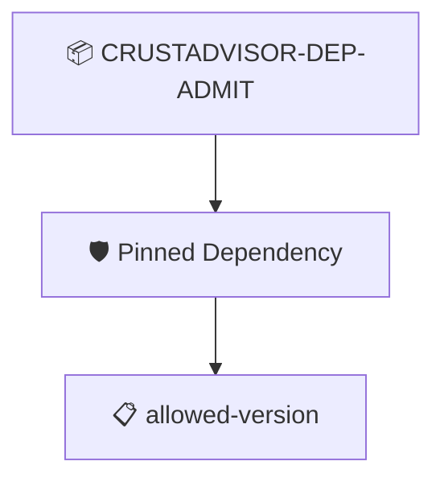

# CrustAdvisor Dependency Admission

The app's dependency SBOM lists crust-receipt only at an allowed version

## Overview

| Property | Value |
|----------|-------|
| **Type** | PolicySet |
| **ID** | `CRUSTADVISOR-DEP-ADMIT` |
| **Enforce** | ON |
| **Policies** | 1 |

## Shared Context

| Name | Type | Required | Default |
|------|------|----------|---------|
| `allowedVersions` |  | no | `list_value:{values:{string_value:"1.0.0"}}` |

## Structure



## Policies

### Pinned Dependency

crust-receipt is present in the SBOM at an allowed version

#### Overview

| Property | Value |
|----------|-------|
| **Type** | Policy |
| **ID** | `DEP-PINNED` |
| **Assert mode** | AND |
| **Tenets** | 1 |
| **Enforce** | ON |

#### Tenets

##### Tenet: `allowed-version`

**Evaluation:**
```cel
size(outputs.versions) > 0 && outputs.versions.all(v, v in context.allowedVersions)
```

**Outputs:**
- `versions`: `size(predicates) > 0 ? sboms[0].get_node_list().get_nodes().filter(n, n.name ...`

**On pass:** crust-receipt {{ .Outputs.versions }} is on the allow list

**On fail:** The app depends on a crust-receipt version we do not allow
**Guidance:** Allowed: {{ .Context.allowedVersions }}, found {{ .Outputs.versions }}. A poisoned release arrives as a version bump; restore the pin (attack/ppm-dependency.sh --undo).

