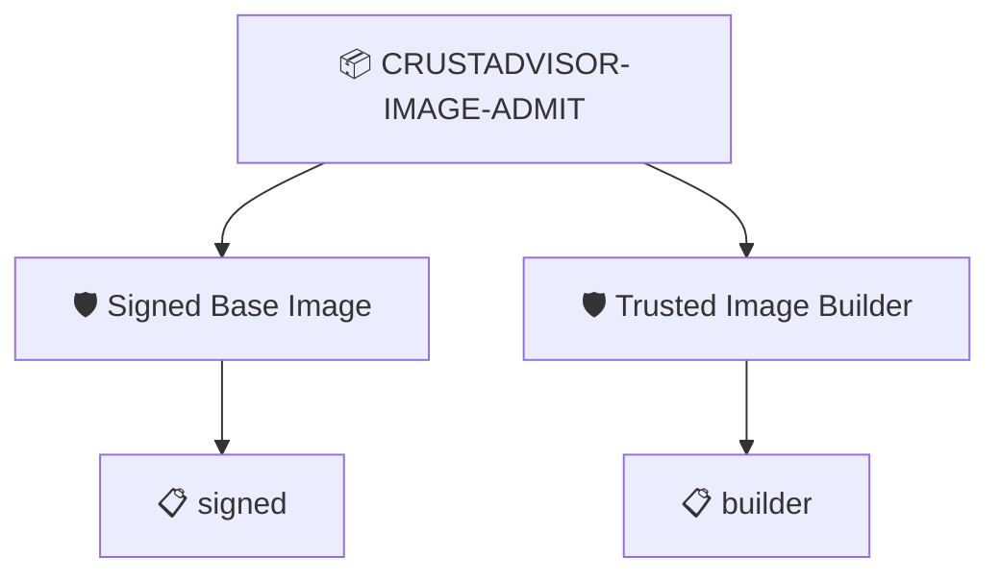

# CrustAdvisor Image Admission

The base image the app is about to be built on carries SLSA provenance bound to its digest, signed by our builder

## Overview

| Property | Value |
|----------|-------|
| **Type** | PolicySet |
| **ID** | `CRUSTADVISOR-IMAGE-ADMIT` |
| **Enforce** | ON |
| **Policies** | 2 |

## Shared Context

| Name | Type | Required | Default |
|------|------|----------|---------|
| `builderId` |  | **yes** | `https://localhost/crustadvisor/image-build` |
| `requireSignature` |  | **yes** | `true` |

## Structure



## Policies

### Signed Base Image

SLSA provenance is bound to this image digest and its signature verifies

#### Overview

| Property | Value |
|----------|-------|
| **Type** | Policy |
| **ID** | `IMAGE-SIGNED` |
| **Assert mode** | AND |
| **Tenets** | 1 |
| **Enforce** | ON |

#### Tenets

##### Tenet: `signed`

**Evaluation:**
```cel
size(predicates) > 0 && (context.requireSignature == 'false' || predicate.verification.verified)
```

**On pass:** Provenance is bound to this base image and its signature verifies

**On fail:** No verified provenance for this base image
**Guidance:** The base tag points at an image with no provenance from our builder. A hijacked :latest fails here. Rebuild the base (image/build-base.sh) or restore it (attack/ppm-image.sh --undo).

### Trusted Image Builder

The base image was built by the CrustAdvisor image build

#### Overview

| Property | Value |
|----------|-------|
| **Type** | Policy |
| **ID** | `IMAGE-BUILDER` |
| **Assert mode** | AND |
| **Tenets** | 1 |
| **Enforce** | ON |

#### Tenets

##### Tenet: `builder`

**Evaluation:**
```cel
outputs.builderId == context.builderId
```

**Outputs:**
- `builderId`: `size(predicates) > 0 && has(predicate.data.runDetails.builder.id) ? predicate...`

**On pass:** Base image built by {{ .Outputs.builderId }}

**On fail:** The base image was built by an unexpected builder
**Guidance:** Expected {{ .Context.builderId }}, the provenance says {{ .Outputs.builderId }}

