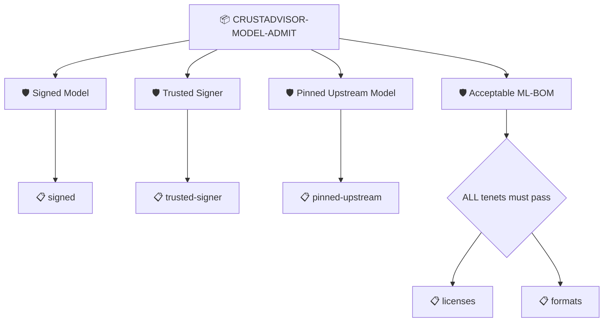

# CrustAdvisor Model Admission

The model about to be served carries a verified OpenSSF Model Signing signature from our build, was built from the pinned upstream model, and is described by an ML-BOM we accept

## Overview

| Property | Value |
|----------|-------|
| **Type** | PolicySet |
| **ID** | `CRUSTADVISOR-MODEL-ADMIT` |
| **Enforce** | ON |
| **Policies** | 4 |

## Shared Context

| Name | Type | Required | Default |
|------|------|----------|---------|
| `allowedFormats` |  | no | `list_value:{values:{string_value:"gguf"} values:{string_value:"safetensors"}}` |
| `allowedLicenses` |  | no | `list_value:{values:{string_value:"Apache-2.0"} values:{string_value:"MIT"}}` |
| `modelRepo` |  | **yes** | `Qwen/Qwen3-4B-Instruct-2507` |
| `modelRevision` |  | **yes** | `cdbee75f17c01a7cc42f958dc650907174af0554` |
| `requireSignature` |  | **yes** | `true` |
| `signerIdentity` |  | **yes** | `^https://github.com/carabiner-labs/crustadvisor/.github/workflows/model-build.yml@refs/(heads/main|tags/v[0-9.]+)$` |
| `signerIssuer` |  | **yes** | `https://token.actions.githubusercontent.com` |

## Structure



## Policies

### Signed Model

OpenSSF Model Signing statement bound to this exact file, with a verified signature

#### Overview

| Property | Value |
|----------|-------|
| **Type** | Policy |
| **ID** | `SIGNATURE` |
| **Assert mode** | AND |
| **Tenets** | 1 |
| **Enforce** | ON |

#### Tenets

##### Tenet: `signed`

**Evaluation:**
```cel
size(predicates) > 0 && outputs.method == 'files' && (context.requireSignature == 'false' || predicate.verification.verified)
```

**Outputs:**
- `method`: `size(predicates) > 0 && has(predicate.data.serialization.method) ? predicate....`

**On pass:** Model signature bound to this file verifies (OMS {{ .Outputs.method }} serialization)

**On fail:** No verified model signature for this file
**Guidance:** Either the file changed after it was signed (its digest matches no signature) or the signature is not verifiable. Pull the signed model again.

### Trusted Signer

The model signature was produced by the CrustAdvisor model-build workflow

#### Overview

| Property | Value |
|----------|-------|
| **Type** | Policy |
| **ID** | `SIGNER-IDENTITY` |
| **Assert mode** | AND |
| **Tenets** | 1 |
| **Enforce** | ON |

#### Tenets

##### Tenet: `trusted-signer`

**Evaluation:**
```cel
size(predicates) > 0 && size(outputs.signerIds) > 0 && (context.requireSignature == 'false' || predicate.verification.signers.exists(s, has(s.sigstore) && s.sigstore.issuer == context.signerIssuer && s.sigstore.identity.matches(context.signerIdentity)))
```

**Outputs:**
- `signerIds`: `size(predicates) > 0 && size(predicate.?verification.?signers.orValue([])) > ...`

**On pass:** Signed by the model-build workflow: {{ .Outputs.signerIds }}

**On fail:** The model was not signed by the model-build workflow
**Guidance:** Expected a sigstore identity matching {{ .Context.signerIdentity }}, found {{ .Outputs.signerIds }}

### Pinned Upstream Model

The build consumed the pinned Hugging Face model at the pinned revision

#### Overview

| Property | Value |
|----------|-------|
| **Type** | Policy |
| **ID** | `PROVENANCE-MATERIALS` |
| **Assert mode** | AND |
| **Tenets** | 1 |
| **Enforce** | ON |

#### Tenets

##### Tenet: `pinned-upstream`

**Evaluation:**
```cel
outputs.materials.exists(uri, uri == 'https://huggingface.co/' + context.modelRepo + '@' + context.modelRevision)
```

**Outputs:**
- `materials`: `size(predicates) > 0 && has(predicate.data.buildDefinition.resolvedDependenci...`

**On pass:** Built from {{ .Context.modelRepo }} @ {{ .Context.modelRevision }}

**On fail:** The model was not built from the pinned upstream
**Guidance:** Expected https://huggingface.co/{{ .Context.modelRepo }}@{{ .Context.modelRevision }}, the provenance says {{ .Outputs.materials }}

### Acceptable ML-BOM

The model and its base model are licensed and serialized in ways we accept

#### Overview

| Property | Value |
|----------|-------|
| **Type** | Policy |
| **ID** | `ML-BOM` |
| **Assert mode** | AND |
| **Tenets** | 2 |
| **Enforce** | ON |

#### Tenets

##### Tenet: `licenses`

**Evaluation:**
```cel
size(outputs.licenses) > 0 && outputs.licenses.all(l, l in context.allowedLicenses)
```

**Outputs:**
- `licenses`: `size(predicates) > 0 ? ([predicate.data.metadata.component] + predicate.data....`

**On pass:** Model licenses on the allow list: {{ .Outputs.licenses }}

**On fail:** A model component is missing a license or carries one we do not accept
**Guidance:** Allowed: {{ .Context.allowedLicenses }}, found: {{ .Outputs.licenses }}

##### Tenet: `formats`

**Evaluation:**
```cel
size(outputs.formats) > 0 && outputs.formats.all(f, f in context.allowedFormats)
```

**Outputs:**
- `formats`: `size(predicates) > 0 ? ([predicate.data.metadata.component] + predicate.data....`

**On pass:** Model formats on the allow list: {{ .Outputs.formats }}

**On fail:** A model component is in a format we do not serve
**Guidance:** Allowed: {{ .Context.allowedFormats }} (no pickle), found: {{ .Outputs.formats }}

