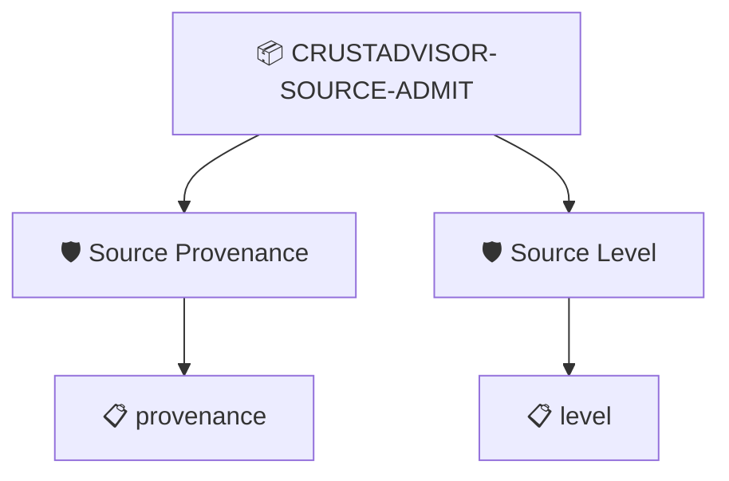

# CrustAdvisor Source Admission

The commit about to be built carries signed SLSA source provenance for this repository's main branch, and a verification summary at the required source level

## Overview

| Property | Value |
|----------|-------|
| **Type** | PolicySet |
| **ID** | `CRUSTADVISOR-SOURCE-ADMIT` |
| **Enforce** | ON |
| **Policies** | 2 |

## Shared Context

| Name | Type | Required | Default |
|------|------|----------|---------|
| `branch` |  | **yes** | `refs/heads/main` |
| `minLevel` |  | **yes** | `1` |
| `repoUri` |  | **yes** | `https://github.com/carabiner-labs/crustadvisor` |
| `requireSignature` |  | **yes** | `true` |
| `signerIdentity` |  | **yes** | `^https://github.com/slsa-framework/actions/.github/workflows/compute_slsa_source.yml@3efdf6f2112b1170cb369442620788752df11bca$` |
| `signerIssuer` |  | **yes** | `https://token.actions.githubusercontent.com` |

## Structure



## Policies

### Source Provenance

Signed SLSA source provenance exists for this commit, about this repository and branch

#### Overview

| Property | Value |
|----------|-------|
| **Type** | Policy |
| **ID** | `SOURCE-PROVENANCE` |
| **Assert mode** | AND |
| **Tenets** | 1 |
| **Enforce** | ON |

#### Tenets

##### Tenet: `provenance`

**Evaluation:**
```cel
size(predicates) > 0 && outputs.repo == context.repoUri && outputs.branch == context.branch && size(outputs.signers) > 0 && (context.requireSignature == 'false' || (predicate.verification.verified && predicate.verification.signers.exists(s, has(s.sigstore) && s.sigstore.issuer == context.signerIssuer && s.sigstore.identity.matches(context.signerIdentity))))
```

**Outputs:**
- `branch`: `size(predicates) > 0 && has(predicate.data.branch) ? predicate.data.branch : ''`
- `repo`: `size(predicates) > 0 && has(predicate.data.repoUri) ? predicate.data.repoUri ...`
- `signers`: `size(predicates) > 0 && size(predicate.?verification.?signers.orValue([])) > ...`

**On pass:** Source provenance for {{ .Outputs.branch }} of {{ .Outputs.repo }}, signed by {{ .Outputs.signers }}

**On fail:** No signed source provenance for this commit
**Guidance:** The commit did not land on {{ .Context.branch }} of {{ .Context.repoUri }} through the repository's process (no provenance in its git note, or it is about another repo or branch, or not signed by the SLSA source workflow). Found: {{ .Outputs.repo }} {{ .Outputs.branch }} {{ .Outputs.signers }}

### Source Level

The SLSA source verification summary for this commit passed at the required level

#### Overview

| Property | Value |
|----------|-------|
| **Type** | Policy |
| **ID** | `SOURCE-LEVEL` |
| **Assert mode** | AND |
| **Tenets** | 1 |
| **Enforce** | ON |

#### Tenets

##### Tenet: `level`

**Evaluation:**
```cel
outputs.result == 'PASSED' && outputs.levels.exists(l, int(l.substring(18)) >= int(context.minLevel))
```

**Outputs:**
- `levels`: `size(predicates) > 0 && has(predicate.data.verifiedLevels) ? predicate.data.v...`
- `result`: `size(predicates) > 0 && has(predicate.data.verificationResult) ? predicate.da...`

**On pass:** Source verification {{ .Outputs.result }} at {{ .Outputs.levels }}

**On fail:** No passing source verification summary at level {{ .Context.minLevel }} or above
**Guidance:** Found result {{ .Outputs.result }} with levels {{ .Outputs.levels }}

